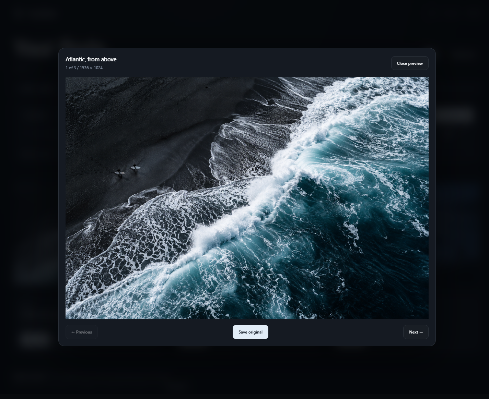

<p></p>

# RightSave Free

Find a photo you want to keep. Right-click it, choose a folder, and save it.

RightSave restores blocked right-click menus and looks through overlays for the media underneath. Open the gallery when you want a better look at everything on the page. Individual saves are unlimited, and you don’t need an account.

[Download for Firefox or Chrome](https://github.com/930turbo/rightsave/releases/latest) · [Install](#install) · [Report a problem](https://github.com/930turbo/rightsave/issues)


## A gallery that gets out of the way

Load the previews you need, or load the whole page’s gallery at once. Stop loading whenever you like. Search by name or link, then narrow things down by format, shape or minimum width. Known unsigned X image size variants can be grouped without changing the chosen original URL.

Click a loaded image for a larger view. Use the arrow keys to browse, or save the original from there. There’s also a Copy link button on each file. Press `/` to jump to search.

RightSave finds regular and lazy-loaded images, CSS backgrounds, accessible frames, canvas and SVG. It can capture the current frame of an unprotected video and save direct MP4/WebM files.

### On social sites

Instagram, Facebook, X, Reddit, Threads and LinkedIn each expose media differently. RightSave reads media details the page has already loaded. Open the post, scroll through its carousel or play its video, then rescan. Higher-quality direct files appear when the page provides them.

Sites change, and some videos aren’t delivered as a single file. Protected playback and segmented streams aren’t combined. Reddit’s separate video tracks are marked **Video only**. [Compatibility details](docs/compatibility.html).

## Install

Get your browser’s ZIP from [Releases](https://github.com/930turbo/rightsave/releases/latest). The packages here are for local installation. Store submissions are being prepared; a store listing is only live once its link is published here.

| Firefox | Chrome |
| --- | --- |
| Open `about:debugging#/runtime/this-firefox`, choose **Load Temporary Add-on…**, and select the Firefox ZIP. | Extract the Chrome ZIP into a folder you’ll keep. Open `chrome://extensions`, enable **Developer mode**, choose **Load unpacked**, and select that folder. |
| Temporary add-ons stay until Firefox restarts. Permanent installation requires Mozilla signing. | Pin RightSave from the Extensions menu so it’s easy to reach. |

Remove an older temporary installation first. Refresh open webpages after installing or updating.

**Right-click Save As** opens the file dialog directly. Turn it off to use the browser’s RightSave submenu instead. Hold **Shift** while right-clicking for the normal browser menu, or **Alt** for website controls. **Alt + Shift + S** opens the gallery.

<details>
<summary>Why does Firefox show a .part file?</summary>

That’s the browser’s temporary download file. It becomes the finished file when the download completes. Wait for the Downloads panel to finish before opening it. Requests for the same active download are combined.

</details>

## Local by design

This repository and its downloads are the Free edition. They don’t make billing requests, load remote scripts or send your media to a developer server. Preferences stay on your device; page scans are temporary. Previews and downloads contact the original media hosts.



[Privacy notice](https://930turbo.github.io/rightsave/privacy.html) · [Support](https://github.com/930turbo/rightsave/issues)

<details>
<summary>Build and verify</summary>

Requires Node.js 22+ and Python 3.

```sh
npm ci
npm run build
npm test
npm run lint:firefox
python scripts/package.py
```

The default build writes Free packages to `build/firefox` and `build/chrome`. There are no runtime dependencies. Browser checks use disposable profiles and local media:

```sh
python -m pip install -r tests/requirements.txt
python tests/integration_firefox.py
python tests/integration_chromium.py
python tests/integration_social.py --browser firefox
python tests/integration_social.py --browser chrome
python tests/integration_gallery.py --browser firefox
python tests/integration_gallery.py --browser chrome
```

Set `FIREFOX_BINARY` or `CHROMIUM_BINARY` if needed. Chrome for Testing supports extension-loading flags. Automated checks cover representative fixtures, not every live logged-in feed. [Latest verification](docs/verification.json).

[Store submission instructions](store/submission.html) and listing assets are included. Store accounts and any required registration remain the publisher’s responsibility.

</details>

Found a bug? Include your browser version, the site and what happened in an [issue](https://github.com/930turbo/rightsave/issues). Keep private media, cookies and signed links out of public reports.

Copyright © 2026 Gianni. Free local use is permitted under [LICENSE](LICENSE); other rights are reserved.
