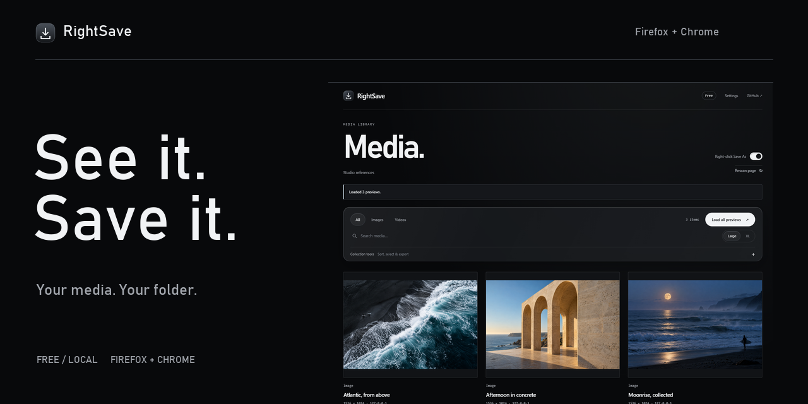
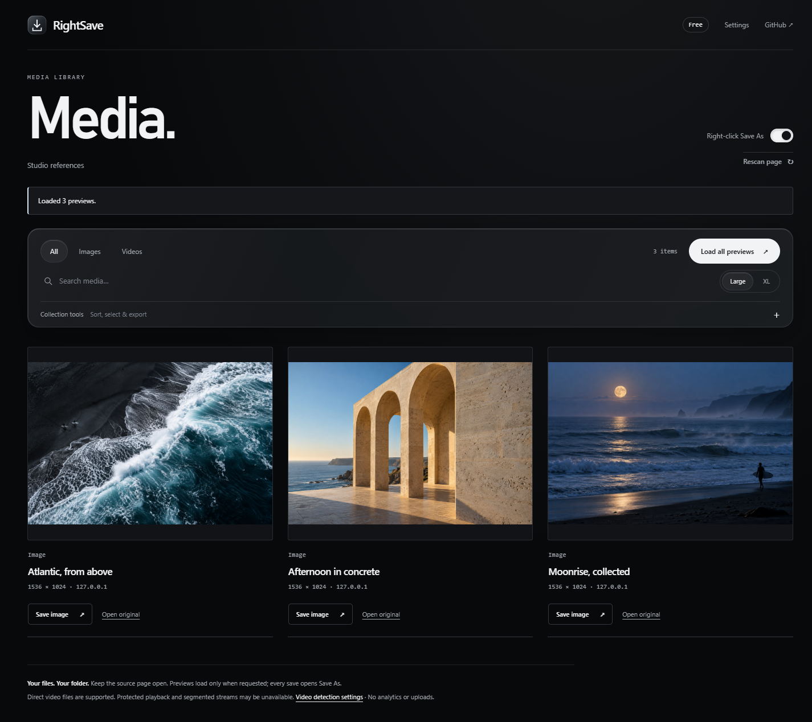
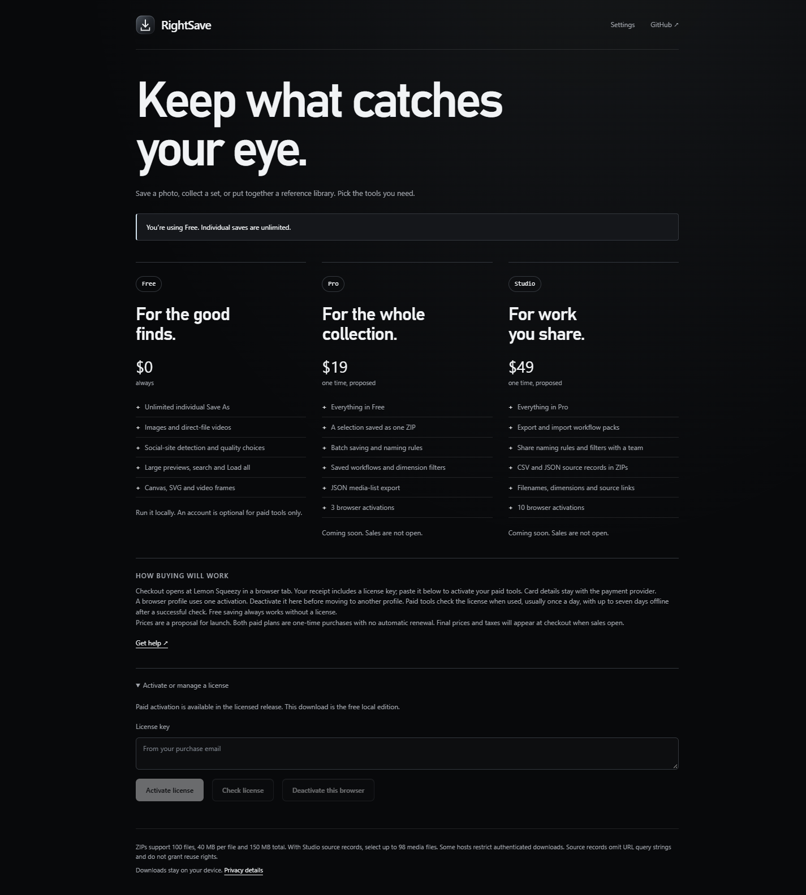

<p align="center"></p>

<p align="center"><a href="https://github.com/930turbo/rightsave/releases/latest"><strong>Download RightSave</strong></a> &nbsp; / &nbsp; <a href="#install-it">Install guide</a> &nbsp; / &nbsp; <a href="#pick-your-tools">Free, Pro &amp; Studio</a> &nbsp; / &nbsp; <a href="https://github.com/930turbo/rightsave/issues">Report a bug</a></p>

# That image you wanted to keep.

RightSave adds a proper Save As to your browser. Right-click a photo or a direct video, choose a folder, and save it. If a page puts an overlay in the way or blocks its right-click menu, RightSave looks for the media underneath.

There’s a gallery for the times you want to see everything on the page. Big previews, a search box, and a **Load all previews** button. It runs in Firefox and Chrome, and the free edition has no limit on individual saves.



### A few things it handles

Images hidden behind overlays. Lazy-loaded photos. CSS backgrounds. Canvas and SVG. The current frame of a video. It can also read media details that supported social pages have already loaded, including higher-quality direct-file choices when the site provides them.

**Instagram · Facebook · X · Reddit · Threads · LinkedIn**

Open the post, scroll through its carousel or play the video, then rescan. Sites change, and a detected video isn’t always a complete downloadable file. Protected playback and segmented streams aren’t supported; Reddit tracks with separate audio are marked **Video only**. [More on compatibility](docs/compatibility.html).

## Install it

[Download the latest release](https://github.com/930turbo/rightsave/releases/latest) and choose your browser’s ZIP. These are local development builds; store installation is coming later.

| Firefox | Chrome |
| --- | --- |
| Open `about:debugging#/runtime/this-firefox`. Choose **Load Temporary Add-on…** and select the Firefox ZIP. | Extract the Chrome ZIP into a folder you’ll keep. Open `chrome://extensions`, enable **Developer mode**, choose **Load unpacked**, and select that folder. |
| Temporary add-ons stay until Firefox restarts. Permanent installation needs a Mozilla-signed release. | Pin RightSave from the Extensions menu so it’s easy to reach. |

Refresh your webpages after installing or updating. Replace any older RightSave installation first.

**Right-click to save.** Leave **Right-click Save As** on for the direct file dialog, or turn it off to use RightSave from the browser’s normal menu. Hold **Shift** while right-clicking for the normal menu, or **Alt** for website controls. **Alt + Shift + S** opens the gallery.

<details>
<summary>Why does Firefox show a .part file?</summary>

That’s the browser’s temporary download file. It becomes the finished file when the download completes. Check Firefox’s Downloads panel before opening it; repeated requests for the same active file are combined.

</details>

## Pick your tools

**The download in this repository is Free.** Keep it, build it, and run it locally without paying. Paid editions add collection and organization tools; basic saving and site compatibility stay in Free.

| | Free | Pro | Studio |
| --- | --- | --- | --- |
| Price | $0 | **$19 once**¹ | **$49 once**¹ |
| Individual saves, all supported sites | Unlimited | Unlimited | Unlimited |
| Large previews, search, sorting, Load all | ✓ | ✓ | ✓ |
| Canvas, SVG and video-frame saves | ✓ | ✓ | ✓ |
| Save a selection as one ZIP | | ✓ | ✓ |
| Batch Save As and filename/folder rules | | ✓ | ✓ |
| Saved workflows and dimension filters | | ✓ | ✓ |
| JSON media-list export | | ✓ | ✓ |
| Share and restore workflow packs | | | ✓ |
| CSV + JSON source records inside ZIPs | | | ✓ |
| Browser activations | No license needed | 3¹ | 10¹ |

¹ Proposed launch pricing and activation counts. **Paid sales are not open yet.** Final prices and taxes will appear at checkout. Neither paid plan renews automatically.

Pro is for collecting a set without saving each file by hand. Studio is for people who reuse the same filters and naming rules across browsers or a small team, and want a record of where files came from. Workflow packs and source records are implemented, along with the Pro tools above.

ZIPs support 100 files, up to 40 MB each and 150 MB total. Including source records leaves room for 98 media files. Some authenticated hosts restrict ZIP fetching; use individual Save As in Firefox containers. Source records omit URL query strings and don’t grant permission to reuse someone else’s work.



### Buying a paid edition

The payment integration uses **Lemon Squeezy hosted checkout**. A receipt supplies a license key; enter it in RightSave to activate that browser. You can check the license, release an activation to move browsers, and find receipts through the provider’s purchases page. The extension never handles card details.

Paid tools normally recheck the license once a day when used, with up to seven days of offline access after a successful check. Invalid or disabled licenses return to Free. The public build has checkout disabled until merchant products are configured. [Payment setup and test checklist](store/billing.html).

## Your files stay yours


Media downloads go from the original host to your browser. RightSave has no analytics or advertising SDK. Preferences and saved workflows stay on your device. Page scans are temporary, and social response processing retains only bounded media fields.

The free build makes no billing requests. In a configured paid build, activation and license checks contact Lemon Squeezy with the license key and a random browser-instance label. Browsing history and saved media aren’t sent to billing. [Privacy details](docs/privacy.html).

<details>
<summary>Build and test from source</summary>

Node.js 22+ and Python 3 are required.

```sh
npm ci
npm run build
npm test
npm run lint:firefox
python scripts/package.py
```

The default build writes the Free edition to `build/firefox` and `build/chrome`. The extension has no runtime dependencies or remote scripts.

For browser integration checks:

```sh
python -m pip install -r tests/requirements.txt
python tests/integration_firefox.py
python tests/integration_chromium.py
python tests/integration_social.py --browser firefox
python tests/integration_social.py --browser chrome
python tests/integration_pro_firefox.py
python tests/integration_studio.py
```

Set `FIREFOX_BINARY` or `CHROMIUM_BINARY` if needed. Chrome for Testing supports extension-loading flags. Tests use disposable profiles and local fixtures, including ephemeral license keys. They check representative social payloads, not every live logged-in feed. [Latest verification](docs/verification.json).

A merchant build uses `node scripts/build.mjs --billing /path/to/billing.json`. Only public store/product IDs and hosted checkout links belong in that file. Start in provider test mode; [the setup guide](store/billing.html) covers activation limits, refunds and launch checks. Signed offline licenses remain available with `--public-key /path/to/public-jwk.json` and `scripts/license.mjs`; keep issuer private keys outside the repository.

The source can be modified locally, so client-side licensing is not tamper-proof. Paid distribution, support and license terms are separate from the free local-use permission.

</details>

<details>
<summary>Publishing, bugs and license terms</summary>

Browser-store accounts and a live merchant account still need to be set up. [Store submission materials](store/submission.html) are included; `npm run sign:firefox` uses locally configured Mozilla credentials.

Found a problem? [Open an issue](https://github.com/930turbo/rightsave/issues) with your browser version, the site and what happened. Keep private media, cookies, signed URLs and license keys out of public reports. Use GitHub’s private vulnerability reporting for security issues when available.

Copyright © 2026 930turbo. Free local use is permitted under [LICENSE](LICENSE); other rights are reserved. This is not an open-source license.

</details>
